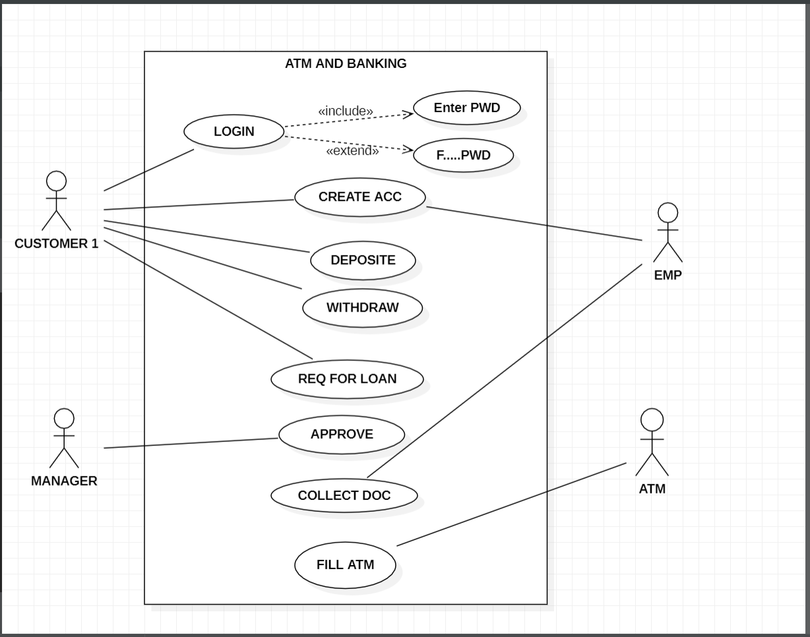
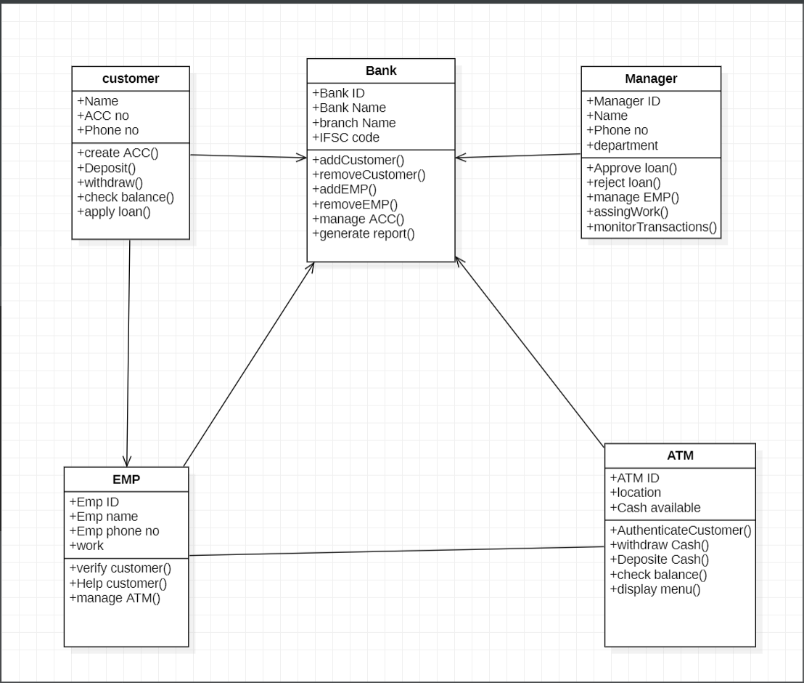
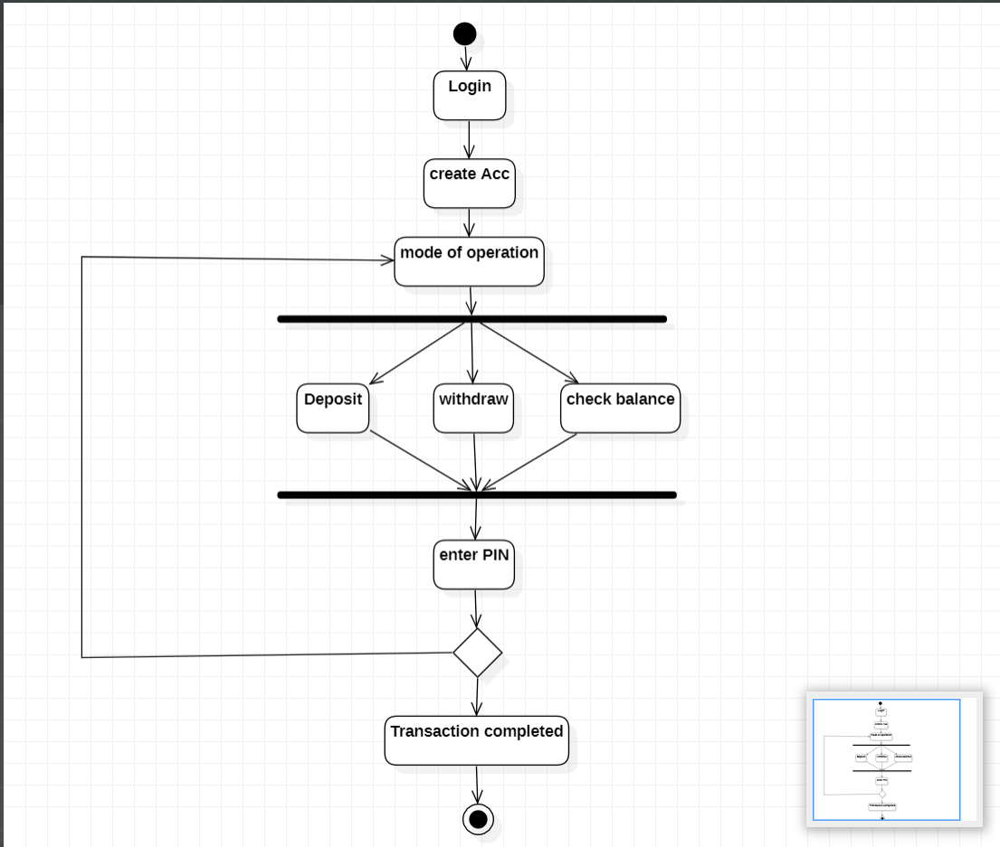
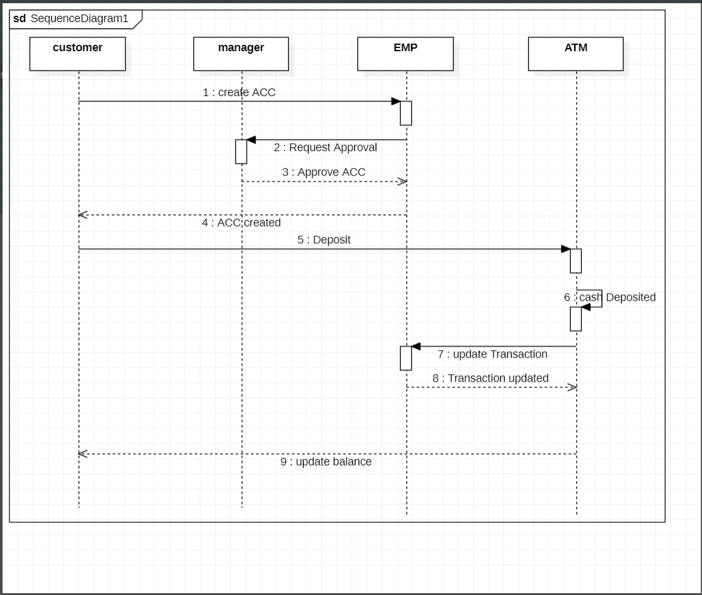
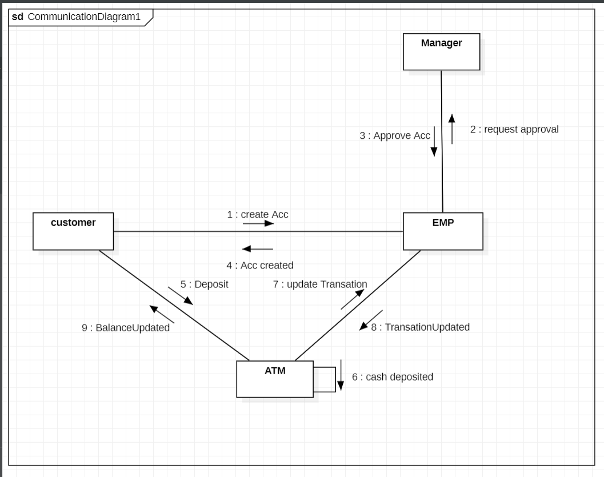
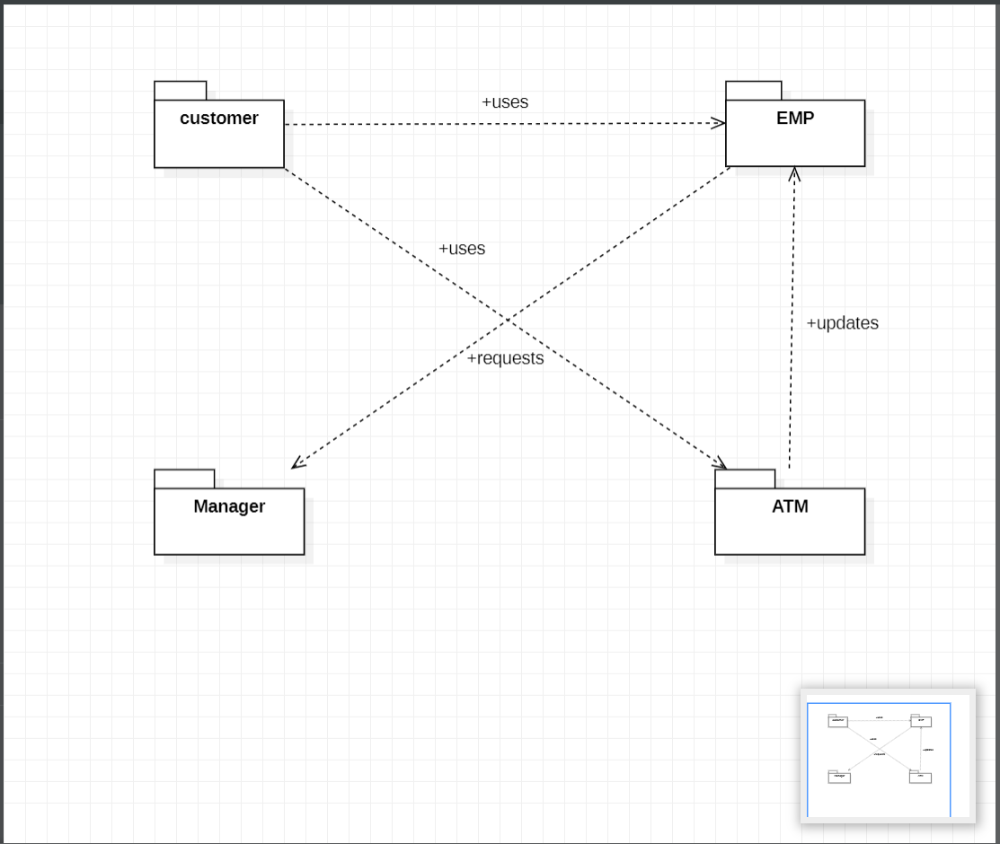

# Exp-1-ATM-BANKING-SYSTEM
# AIM:
To design and develop UML diagrams for an ATM Banking System to represent its structure, functions, and interactions between the customer, manager, employee, and ATM.
# SRS (Procedure):
## Step 1: Problem Identification

The main problem is the need for a fast, secure, and automated system that allows customers to perform banking transactions (like withdrawal, deposit, and fund transfer) without depending on bank staff.

## Step 2: Requirement Analysis

Identify user needs (customer, admin, staff).      
Define functional requirements: login, balance check, withdrawal, deposit, transfer, PIN change.      
Define non-functional requirements: speed, security, reliability, and usability.      

## Step 3: System Design

Draw UML diagrams to represent the system:      
Use Case Diagram      
Class Diagram      
Activity Diagram      
Sequence Diagram      
Communication Diagram      
Package Diagram      
Design the database with tables for Customer, Account, and Transaction.

# DIAGRAMS:
## Use Case Diagram

## Class Diagram  

## Activity Diagram 

## Sequence Diagram  

## Communication Diagram 

## Package Diagram  

# RESULT:
Thus, the UML diagrams for the ATM Banking System were designed successfully to represent its structure, functionality, and interactions between the customer, manager, employee, and ATM.